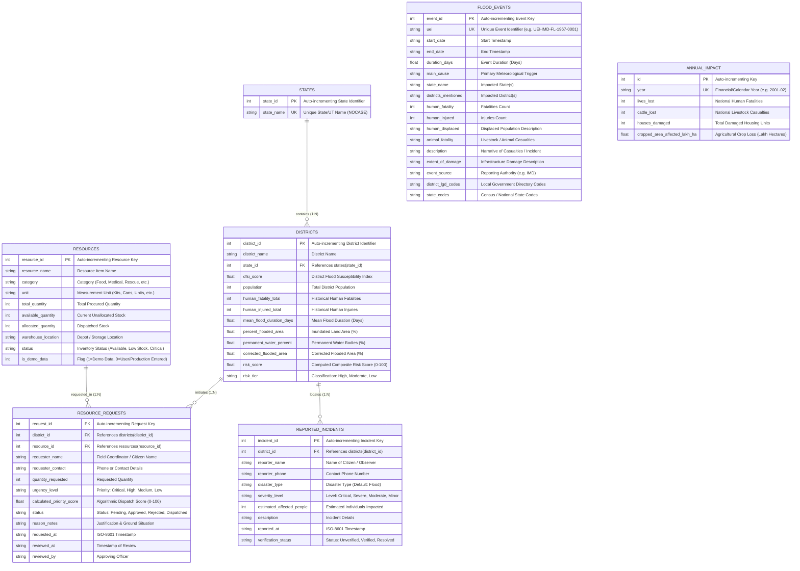

# Disaster Resource Tracker — Database Schema & Data Dictionary

## 1. Overview

The **Disaster Resource Tracker** utilizes a relational SQLite database (`disaster_tracker.db`) designed to support:
1. Unified exploration of Indian disaster records across states and districts.
2. Ingestion and preservation of all five cleaned datasets without data loss.
3. Multi-criteria vulnerability and risk analysis.
4. Operational disaster resource management, relief request triage, and incident reporting.

Strict foreign key constraints (`PRAGMA foreign_keys = ON;`), relational integrity checks, and performance indexes are enforced on every connection.

---

## 2. Entity-Relationship (ER) Diagram

---

## 3. Data Dictionary & Table Definitions

### Table 1: `states`
Master table for all States and Union Territories of India.
* **`state_id`**: INTEGER, PRIMARY KEY, AUTOINCREMENT.
* **`state_name`**: TEXT, UNIQUE, NOT NULL, COLLATE NOCASE.

### Table 2: `districts`
Unified relational master created by synthesizing **Dataset 1 (`cleaned_DFSI.csv`)**, **Dataset 2 (`cleaned_District_FloodImpact.csv`)**, and **Dataset 3 (`cleaned_District_FloodedArea.csv`)**.
* **`district_id`**: INTEGER, PRIMARY KEY, AUTOINCREMENT.
* **`district_name`**: TEXT, NOT NULL, COLLATE NOCASE.
* **`state_id`**: INTEGER, NOT NULL, FOREIGN KEY REFERENCES `states(state_id)`.
* **`dfsi_score`**: REAL, District Flood Susceptibility Index score.
* **`population`**: INTEGER, District census population count.
* **`human_fatality_total`**: INTEGER, Cumulative human fatalities.
* **`human_injured_total`**: INTEGER, Cumulative human injuries.
* **`mean_flood_duration_days`**: REAL, Mean inundation period in days.
* **`percent_flooded_area`**: REAL, Percentage of district land area submerged.
* **`permanent_water_percent`**: REAL, Permanent water bodies percentage.
* **`corrected_flooded_area`**: REAL, Net flood area percentage excluding permanent water.
* **`risk_score`**: REAL, Composite risk metric computed by project heuristic algorithm (0 to 100).
* **`risk_tier`**: TEXT, Risk level classification (`High`, `Moderate`, `Low`).
* **Constraints**: `UNIQUE (district_name, state_id)`.

### Table 3: `flood_events`
Historical archive of flood events in India from **Dataset 4 (`cleaned_India_Flood_Inventory_v3.csv`)**.
* **`event_id`**: INTEGER, PRIMARY KEY, AUTOINCREMENT.
* **`uei`**: TEXT, UNIQUE, NOT NULL — Unique Event Identifier.
* **`start_date`**: TEXT, Start timestamp.
* **`end_date`**: TEXT, End timestamp.
* **`duration_days`**: REAL, Duration in days.
* **`main_cause`**: TEXT, Primary meteorological trigger (e.g. heavy rains).
* **`state_name`**: TEXT, Affected state(s).
* **`districts_mentioned`**: TEXT, Mentioned districts.
* **`human_fatality`**: INTEGER, Fatalities count (defaults to 0).
* **`human_injured`**: INTEGER, Injury count (defaults to 0).
* **`human_displaced`**: TEXT, Displaced population narrative.
* **`animal_fatality`**: TEXT, Livestock losses.
* **`description`**: TEXT, Ground description of casualties and damage.
* **`extent_of_damage`**: TEXT, Structural and agricultural impact narrative.
* **`event_source`**: TEXT, Data source (e.g. IMD).
* **`district_lgd_codes`**: TEXT, Local Government Directory codes.
* **`state_codes`**: TEXT, Official state codes.

### Table 4: `annual_impact`
Longitudinal national summary from **Dataset 5 (`cleaned_disaster_dataset_1.csv`)**.
* **`id`**: INTEGER, PRIMARY KEY, AUTOINCREMENT.
* **`year`**: TEXT, UNIQUE, NOT NULL (e.g. "2001-02" through "2012-13").
* **`lives_lost`**: INTEGER, NOT NULL.
* **`cattle_lost`**: INTEGER, NOT NULL.
* **`houses_damaged`**: INTEGER, NOT NULL.
* **`cropped_area_affected_lakh_ha`**: REAL, NOT NULL.

### Table 5: `resources`
Operational inventory for emergency relief supplies.
* **`resource_id`**: INTEGER, PRIMARY KEY, AUTOINCREMENT.
* **`resource_name`**: TEXT, NOT NULL.
* **`category`**: TEXT, NOT NULL (e.g. Food & Water, Medical Supplies, Rescue Equipment, Shelter, Power & Utility).
* **`unit`**: TEXT, NOT NULL (e.g. Cans, Kits, Boats, Tents, Units, Bottles).
* **`total_quantity`**: INTEGER, NOT NULL, CHECK(`total_quantity >= 0`).
* **`available_quantity`**: INTEGER, NOT NULL, CHECK(`available_quantity >= 0`).
* **`allocated_quantity`**: INTEGER, NOT NULL DEFAULT 0, CHECK(`allocated_quantity >= 0`).
* **`warehouse_location`**: TEXT, NOT NULL.
* **`status`**: TEXT, CHECK(`status IN ('Available', 'Low Stock', 'Critical')`).
* **`is_demo_data`**: INTEGER, NOT NULL CHECK(`is_demo_data IN (0, 1)`). Explicitly flags initial mock supplies.

### Table 6: `resource_requests`
Workflow management for field requests and administrative approvals.
* **`request_id`**: INTEGER, PRIMARY KEY, AUTOINCREMENT.
* **`district_id`**: INTEGER, NOT NULL, FOREIGN KEY REFERENCES `districts(district_id)`.
* **`resource_id`**: INTEGER, NOT NULL, FOREIGN KEY REFERENCES `resources(resource_id)`.
* **`requester_name`**: TEXT, NOT NULL.
* **`requester_contact`**: TEXT, NOT NULL.
* **`quantity_requested`**: INTEGER, NOT NULL, CHECK(`quantity_requested > 0`).
* **`urgency_level`**: TEXT, NOT NULL, CHECK(`urgency_level IN ('Critical', 'High', 'Medium', 'Low')`).
* **`calculated_priority_score`**: REAL, NOT NULL DEFAULT 0.0.
* **`status`**: TEXT, NOT NULL DEFAULT 'Pending', CHECK(`status IN ('Pending', 'Approved', 'Rejected', 'Dispatched')`).
* **`reason_notes`**: TEXT.
* **`requested_at`**: TEXT, NOT NULL, DEFAULT `(datetime('now'))`.
* **`reviewed_at`**: TEXT.
* **`reviewed_by`**: TEXT.

### Table 7: `reported_incidents`
Incident intake for citizens and local observers.
* **`incident_id`**: INTEGER, PRIMARY KEY, AUTOINCREMENT.
* **`district_id`**: INTEGER, FOREIGN KEY REFERENCES `districts(district_id)`.
* **`reporter_name`**: TEXT, NOT NULL.
* **`reporter_phone`**: TEXT, NOT NULL.
* **`disaster_type`**: TEXT, NOT NULL DEFAULT 'Flood'.
* **`severity_level`**: TEXT, NOT NULL, CHECK(`severity_level IN ('Critical', 'Severe', 'Moderate', 'Minor')`).
* **`estimated_affected_people`**: INTEGER DEFAULT 0.
* **`description`**: TEXT, NOT NULL.
* **`reported_at`**: TEXT, NOT NULL, DEFAULT `(datetime('now'))`.
* **`verification_status`**: TEXT, NOT NULL DEFAULT 'Unverified', CHECK(`verification_status IN ('Unverified', 'Verified', 'Resolved')`).

---

## 4. Multi-State District Resolution Analysis

During data ingestion, cross-dataset verification confirmed that **720 district names in India exist in exactly one state**. However, **6 district names exist in two different states**:

| District Name | State 1 | State 2 | Resolution Methodology |
| :--- | :--- | :--- | :--- |
| **Aurangabad** | Bihar (Pop: 3,160,597) | Maharashtra (Pop: 4,525,057) | Differentiated by census population and surrounding state clusters in dataset order |
| **Balrampur** | Chhattisgarh (Pop: 853,775) | Uttar Pradesh (Pop: 2,570,002) | Differentiated by spatial sequence (Row 138 vs Row 656) |
| **Bilaspur** | Chhattisgarh (Pop: 2,180,689) | Himachal Pradesh (Pop: 517,758) | Differentiated by spatial sequence (Row 141 vs Row 222) |
| **Hamirpur** | Himachal Pradesh (Pop: 502,514) | Uttar Pradesh (Pop: 1,250,794) | Differentiated by spatial sequence (Row 221 vs Row 657) |
| **Pratapgarh** | Rajasthan (Pop: 1,070,109) | Uttar Pradesh (Pop: 3,854,756) | Differentiated by spatial sequence (Row 538 vs Row 658) |
| **Raigarh** | Chhattisgarh (Pop: 1,654,533) | Maharashtra (Pop: 3,072,698) | Differentiated by spatial sequence (Row 140 vs Row 402) |

By indexing on `(district_name, state_id)`, all 732 physical administrative districts are uniquely stored without collision or data loss.

---

## 5. Algorithmic Risk-Scoring Heuristic Documentation

### 5.1 Project Heuristic Disclaimer
> [!NOTE]
> The risk-scoring formula implemented in `backend/algorithms.py` is a **project heuristic model** formulated for academic evaluation and resource allocation modeling. It adapts multi-criteria decision analysis (MCDA) principles to combine empirical vulnerability data with disaster history.

### 5.2 Mathematical Formulation
Each variable $x$ is normalized linearly using Min-Max scaling to a scale of $[0, 100]$:
$$\text{Norm}(x) = \frac{x - x_{\min}}{x_{\max} - x_{\min}} \times 100$$

The composite **District Risk Score** is calculated as:
$$\text{RiskScore} = (w_1 \cdot \text{Norm}(\text{DFSI})) + (w_2 \cdot \text{Norm}(\text{FloodedArea})) + (w_3 \cdot \text{Norm}(\text{CasualtyRate})) + (w_4 \cdot \text{Norm}(\text{Duration}))$$

### 5.3 Weight Breakdown & Justification
* **$w_1 = 0.35$ (DFSI - District Flood Susceptibility Index)**: Primary empirical indicator derived from topographical slope, drainage density, and soil permeability.
* **$w_2 = 0.30$ (Corrected Percent Flooded Area)**: Measures physical exposure and inundation severity.
* **$w_3 = 0.20$ (Casualty Rate per 100k population)**: Human vulnerability metric: $(\text{Fatalities} + 0.5 \times \text{Injuries}) / \text{Population} \times 100,000$.
* **$w_4 = 0.15$ (Mean Flood Duration)**: Disaster persistence indicator measuring recovery difficulty.

### 5.4 Risk Classification Tiers
* **High Risk**: $\text{RiskScore} \ge 60.0$
* **Moderate Risk**: $30.0 \le \text{RiskScore} < 60.0$
* **Low Risk**: $\text{RiskScore} < 30.0$

---

## 6. Verification and Integrity Metrics

| Entity | Cleaned CSV Source | Seeded DB Rows | Integrity Status |
| :--- | :--- | :--- | :--- |
| **States** | Extracted from Datasets 1, 2, 3 | **37** | Verified (37 States/UTs) |
| **Districts** | Merged Datasets 1, 2, 3 | **732** | Verified (All 732 districts resolved) |
| **Flood Events** | `cleaned_India_Flood_Inventory_v3.csv` | **6,876** | Verified (All 6,876 events imported) |
| **Annual Impact** | `cleaned_disaster_dataset_1.csv` | **12** | Verified (All 12 financial years) |
| **Resources** | Initial relief items (Demo flagged) | **8** | Verified (`is_demo_data = 1`) |
| **Automated Tests** | `backend/tests/test_phase1_db.py` | **6 / 6 Passed** | Verified in 0.033s |
## 7. Database Normalization

The Disaster Resource Tracker uses relational database design principles to reduce data duplication and maintain data consistency.

### 7.1 First Normal Form (1NF)

First Normal Form requires:
- Each table to have a primary key.
- Each column to contain a single value.
- No repeating groups or multi-valued attributes.

The states, districts, resources, resource_requests, annual_impact, and reported_incidents tables use individual columns for their attributes.

**Normalization limitation:** The flood_events table contains source-import fields such as districts_mentioned and district_lgd_codes that can store multiple comma-separated values in a single column. Therefore, this table does not strictly satisfy 1NF for those fields.

### 7.2 Second Normal Form (2NF)

Second Normal Form requires:
- The table to satisfy 1NF.
- Every non-key attribute to depend on the entire candidate key.
- No partial functional dependencies.

The application tables primarily use single-column surrogate primary keys, such as state_id, district_id, resource_id, request_id, and incident_id.

Because these tables use single-column primary keys, partial dependencies on parts of a composite primary key do not arise.

The flood_events table's multi-valued fields remain a normalization limitation.

### 7.3 Third Normal Form (3NF)

Third Normal Form requires:
- The table to satisfy 2NF.
- No transitive dependencies between non-key attributes.

The database separates related entities into independent tables:

1. states stores state information.
2. districts stores district information and references states through state_id.
3. resources stores emergency inventory information.
4. resource_requests references districts and resources through foreign keys.
5. reported_incidents references districts through district_id.

This separation reduces repeated storage of state, district, and resource information.

The schema follows 3NF-oriented relational design principles in its master and operational tables. However, complete 3NF compliance is not claimed for every table.

### 7.4 Normalization Improvement

A future improvement would be to create a separate event_districts junction table containing event_id and district_id.

This would represent the many-to-many relationship between flood events and districts using individual records instead of comma-separated district values.

### 7.5 Conclusion

The database uses primary keys, foreign keys, unique constraints, and separated relational entities to improve data integrity and reduce duplication.

Most master and operational tables follow normalized relational design principles. The historical flood-event import retains certain multi-valued source fields, which are identified as an area for future normalization improvement.
